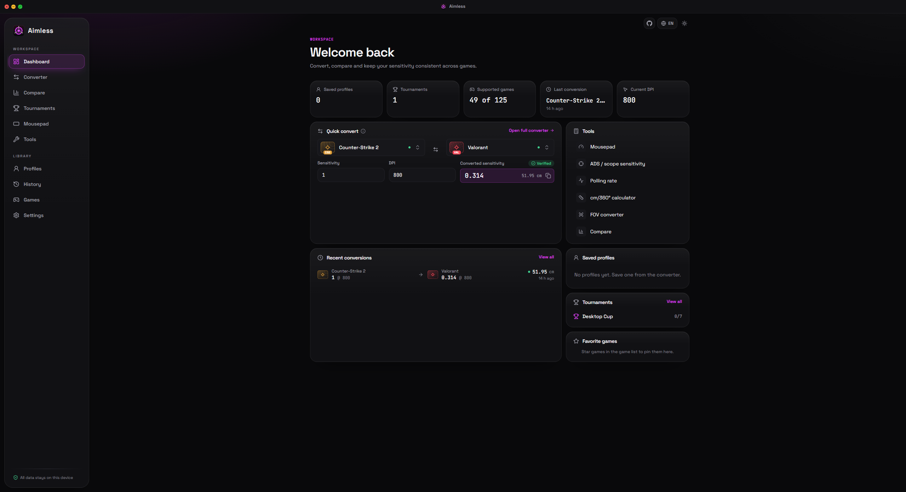
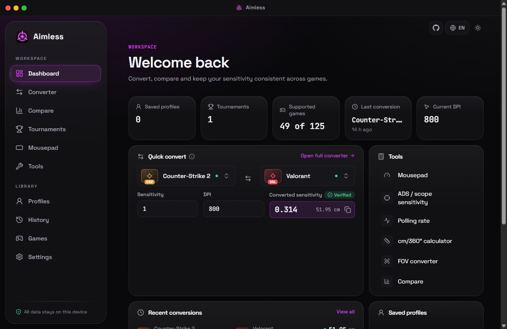
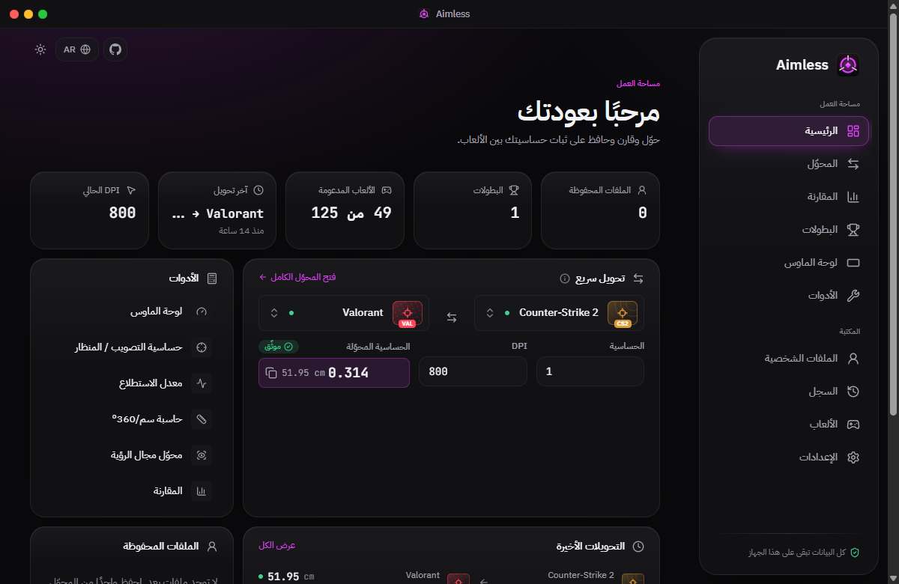

<div align="center">


# Aimless

**One aim. Every game.**<br />
**سنس واحد. لكل الألعاب.**

The local-first FPS toolkit: a mouse sensitivity converter that matches the real distance of a 360° turn, plus tournament brackets, a mousepad visualizer and aim calculators. Five languages, honest accuracy labels for every game.

[](https://github.com/pzxe/Aimless/actions/workflows/ci.yml)
[](https://pzxe.github.io/Aimless/)
[](https://github.com/pzxe/Aimless/releases/latest)
[](LICENSE)
[](tsconfig.app.json)
[](package.json)
[](#-languages)
[](#-privacy-and-security)

[](https://pzxe.github.io/Aimless/)
[](https://github.com/pzxe/Aimless/releases/latest)
[](https://github.com/pzxe/Aimless/issues)


</div>

<details>
<summary><b>🌍 نبذة عن الأداة بالعربية</b></summary>
<br />
<div dir="rtl">

**Aimless** أداة مجانية ومفتوحة المصدر للاعبي ألعاب التصويب. تطابق **المسافة الفعلية التي يتحركها الماوس لدورة كاملة 360°** (سم/360°) بين الألعاب باستخدام ثابت الدوران الخاص بكل لعبة.

- **محوّل دقيق** لـ 125 لعبة، لكل منها مستوى دقة واضح: *موثّق* أو *تقريبي* أو *معايَر* أو *غير مدعوم*. لا نخمّن أي ثابت.
- **جداول بطولات** بنظام الإقصاء الفردي أو المزدوج، فردي أو ثنائي أو فرق مخصصة، مع سحب عشوائي وسلاسل من Bo1 إلى Bo15 ونتيجة كل مباراة.
- **مُصوِّر لوحة الماوس** و**مقياس أسلوب التصويب** وحاسبات **التصويب بالمنظار** و**معدل الاستطلاع**.
- **خصوصية كاملة:** كل البيانات تبقى على جهازك، بلا حسابات ولا تتبّع ولا اتصال بالإنترنت.
- **خمس لغات** مع واجهة عربية كاملة من اليمين إلى اليسار.

**التشغيل:** جرّب [النسخة على الويب](https://pzxe.github.io/Aimless/) أو حمّل [تطبيق ويندوز](https://github.com/pzxe/Aimless/releases/latest). النسخ غير موقّعة رقميًا، لذا قد يظهر تحذير SmartScreen: اختر «مزيد من المعلومات» ثم «التشغيل على أي حال».

</div>
</details>

---

## ✨ What's inside

| | |
|---|---|
| 🎯 **Sensitivity converter** | 125 games, independent DPI, live cm/360° and eDPI, the nearest value the target game accepts, and a step-by-step calculation. |
| 🏷️ **Honest accuracy labels** | Every result is *Verified*, *Approximate*, *Calibrated* or *Unsupported*, with notes explaining why. No constants are invented. |
| 🏆 **Tournament brackets** | Solo (1v1), duo (2v2) or custom team sizes; single or double elimination with an optional grand-final reset; a 🎲 Randomize draw; Bo1 to Bo15 series set per stage; game-by-game results (map, score, overtime) that decide the series automatically; byes, rosters and JSON / SVG / PNG export. |
| 🖱️ **Mousepad visualizer** | Your 360° turn drawn to scale on a small, medium, large, XL or custom pad, with an overflow warning. |
| 🎚️ **Aim style meter** | Classifies your cm/360° as wrist (< 25 cm), hybrid (25–40 cm) or arm (> 40 cm) aim, with ergonomic notes. |
| 🔭 **ADS / scope calculator** | Focal-length (0%) and monitor-distance matching from FOV, magnification or a custom multiplier. |
| 📶 **Polling rate calculator** | Counts per report and the minimum hand speed at 1000, 2000, 4000 and 8000 Hz. |
| 📊 **Compare, profiles, history** | Match several games to one reference, save and share profiles, and reuse past conversions. |
| 🌐 **Five languages** | English, العربية (full RTL), Español, Русский and Português. |
| ⓘ **Help everywhere** | Hover or focus the ⓘ next to any field, calculator, tournament control or setting for a plain explanation, in all five languages. |
| 🎨 **Settings that matter** | cm or inches, pad size, five accent colours, comfortable or compact density, full / reduced / instant (0 ms) motion, startup view and optional sound feedback. |
| 🔒 **Local-first** | No accounts, no telemetry, no network requests. Runs in the browser or as an offline Windows app. |

## 🎬 In action

| Converter | Tournament brackets |
|---|---|
|  |  |
| **Compare + Arabic RTL + themes** | |
|  | |

## 📸 Screenshots

| | |
|---|---|
|  |  |
| **Landing page.** The converter, a tournament series and the aim tools in one hero, with a live converter below. | **Converter.** Valorant → Overwatch 2, with the nearest value the game accepts and the step-by-step calculation. |
|  |  |
| **Tournaments.** Double elimination with scores, connectors and highlighted ready matches. | **Mousepad.** One full turn to scale on a 45 cm pad, and the aim style it suits. |
|  |  |
| **Compare.** Four games matched to the same cm/360°. | **Arabic (RTL).** The whole interface mirrors for right-to-left reading. |
|  |  |

| | |
|---|---|
|  |  |
| **Games.** Every constant is labelled, and any game can be calibrated. | |

## 🎮 Supported games

**125 games:** 25 verified, 24 approximate and 76 unsupported. Each game has its own original emblem, bundled with the app (no official logos, no hotlinks).

<details>
<summary><b>Show all 125 games and their constants</b></summary>

| Game | Yaw (°/count at sens 1) | Accuracy |
|---|---|---|
| Valorant | 0.07 | ✅ Verified |
| Counter-Strike 2 | 0.022 | ✅ Verified |
| Counter-Strike: Global Offensive | 0.022 | ✅ Verified |
| Apex Legends | 0.022 | ✅ Verified |
| Overwatch 2 | 0.0066 | ✅ Verified |
| Fortnite | 0.005555 | 🟡 Approximate |
| Rainbow Six Siege | 0.00572957795 | 🟡 Approximate |
| Call of Duty: Warzone | 0.0066 | ✅ Verified |
| Call of Duty: Black Ops 6 | 0.0066 | ✅ Verified |
| Call of Duty: Black Ops 7 | 0.0066 | 🟡 Approximate |
| PUBG: Battlegrounds | — | ⛔ Unsupported |
| Team Fortress 2 | 0.022 | ✅ Verified |
| Quake Live | 0.022 | ✅ Verified |
| Quake Champions | 0.022 | 🟡 Approximate |
| Destiny 2 | 0.0066 | 🟡 Approximate |
| Battlefield 6 | — | ⛔ Unsupported |
| The Finals | — | ⛔ Unsupported |
| XDefiant | — | ⛔ Unsupported |
| Halo Infinite | — | ⛔ Unsupported |
| Splitgate 2 | — | ⛔ Unsupported |
| Counter-Strike: Source | 0.022 | ✅ Verified |
| Counter-Strike 1.6 | 0.022 | ✅ Verified |
| Day of Defeat: Source | 0.022 | ✅ Verified |
| Insurgency (2014) | 0.022 | 🟡 Approximate |
| Insurgency: Sandstorm | — | ⛔ Unsupported |
| Rainbow Six Extraction | — | ⛔ Unsupported |
| Ready or Not | — | ⛔ Unsupported |
| Ground Branch | — | ⛔ Unsupported |
| Spectre Divide | — | ⛔ Unsupported |
| FragPunk | — | ⛔ Unsupported |
| CrossFire | — | ⛔ Unsupported |
| Warface | — | ⛔ Unsupported |
| Black Mesa | 0.022 | ✅ Verified |
| Battlefield 2042 | — | ⛔ Unsupported |
| Battlefield V | — | ⛔ Unsupported |
| Battlefield 1 | — | ⛔ Unsupported |
| Battlefield 4 | — | ⛔ Unsupported |
| Battlefield 3 | — | ⛔ Unsupported |
| Squad | — | ⛔ Unsupported |
| Hell Let Loose | — | ⛔ Unsupported |
| Arma 3 | — | ⛔ Unsupported |
| Arma Reforger | — | ⛔ Unsupported |
| Rising Storm 2: Vietnam | — | ⛔ Unsupported |
| Verdun | — | ⛔ Unsupported |
| Enlisted | — | ⛔ Unsupported |
| Delta Force (2024) | — | ⛔ Unsupported |
| Star Wars Battlefront II (2017) | — | ⛔ Unsupported |
| Call of Duty: Modern Warfare (2019) | 0.0066 | 🟡 Approximate |
| Call of Duty: Modern Warfare II (2022) | 0.0066 | 🟡 Approximate |
| Call of Duty: Modern Warfare III (2023) | 0.0066 | 🟡 Approximate |
| Call of Duty: Black Ops Cold War | 0.0066 | 🟡 Approximate |
| Call of Duty: Vanguard | 0.0066 | 🟡 Approximate |
| Call of Duty: Black Ops 4 | — | ⛔ Unsupported |
| Call of Duty 4: Modern Warfare | 0.022 | 🟡 Approximate |
| Call of Duty: Modern Warfare 2 (2009) | 0.022 | 🟡 Approximate |
| Call of Duty: Black Ops (2010) | 0.022 | 🟡 Approximate |
| Farlight 84 | — | ⛔ Unsupported |
| Blood Strike | — | ⛔ Unsupported |
| Realm Royale | — | ⛔ Unsupported |
| Bloodhunt | — | ⛔ Unsupported |
| Super People | — | ⛔ Unsupported |
| Z1 Battle Royale | — | ⛔ Unsupported |
| Call of Duty: Warzone Mobile | — | ⛔ Unsupported |
| Quake (1996) | 0.022 | ✅ Verified |
| Quake II | 0.022 | ✅ Verified |
| Quake III Arena | 0.022 | ✅ Verified |
| Quake 4 | 0.022 | 🟡 Approximate |
| Wolfenstein: Enemy Territory | 0.022 | ✅ Verified |
| Return to Castle Wolfenstein | 0.022 | ✅ Verified |
| Star Wars Jedi Knight: Jedi Academy | 0.022 | 🟡 Approximate |
| Medal of Honor: Allied Assault | 0.022 | 🟡 Approximate |
| Xonotic | 0.022 | 🟡 Approximate |
| Warsow | 0.022 | 🟡 Approximate |
| Diabotical | — | ⛔ Unsupported |
| Reflex Arena | — | ⛔ Unsupported |
| Unreal Tournament 2004 | — | ⛔ Unsupported |
| Unreal Tournament 3 | — | ⛔ Unsupported |
| Unreal Tournament (1999) | — | ⛔ Unsupported |
| Toxikk | — | ⛔ Unsupported |
| Krunker | — | ⛔ Unsupported |
| Splitgate (2019) | — | ⛔ Unsupported |
| Halo: The Master Chief Collection | — | ⛔ Unsupported |
| Titanfall 2 | 0.022 | 🟡 Approximate |
| Titanfall | 0.022 | 🟡 Approximate |
| Doom (2016) | 0.022 | 🟡 Approximate |
| Doom Eternal | 0.022 | 🟡 Approximate |
| Doom 3 | 0.022 | 🟡 Approximate |
| Overwatch (2016) | 0.0066 | ✅ Verified |
| Team Fortress Classic | 0.022 | ✅ Verified |
| Paladins | — | ⛔ Unsupported |
| Marvel Rivals | — | ⛔ Unsupported |
| Deadlock | — | ⛔ Unsupported |
| Concord | — | ⛔ Unsupported |
| Strinova | — | ⛔ Unsupported |
| Rogue Company | — | ⛔ Unsupported |
| Battleborn | — | ⛔ Unsupported |
| Escape from Tarkov | — | ⛔ Unsupported |
| Hunt: Showdown 1896 | — | ⛔ Unsupported |
| Arena Breakout: Infinite | — | ⛔ Unsupported |
| Gray Zone Warfare | — | ⛔ Unsupported |
| ARC Raiders | — | ⛔ Unsupported |
| The Cycle: Frontier | — | ⛔ Unsupported |
| Rust | — | ⛔ Unsupported |
| DayZ | — | ⛔ Unsupported |
| Half-Life | 0.022 | ✅ Verified |
| Half-Life 2 | 0.022 | ✅ Verified |
| Portal 2 | 0.022 | ✅ Verified |
| Left 4 Dead 2 | 0.022 | ✅ Verified |
| Garry's Mod | 0.022 | ✅ Verified |
| Deep Rock Galactic | — | ⛔ Unsupported |
| Payday 2 | — | ⛔ Unsupported |
| Payday 3 | — | ⛔ Unsupported |
| Back 4 Blood | — | ⛔ Unsupported |
| Killing Floor 2 | — | ⛔ Unsupported |
| Borderlands 3 | — | ⛔ Unsupported |
| Borderlands 2 | — | ⛔ Unsupported |
| Metro Exodus | — | ⛔ Unsupported |
| Far Cry 6 | — | ⛔ Unsupported |
| Far Cry 5 | — | ⛔ Unsupported |
| Cyberpunk 2077 | — | ⛔ Unsupported |
| Atomic Heart | — | ⛔ Unsupported |
| Wolfenstein II: The New Colossus | — | ⛔ Unsupported |
| Serious Sam 4 | — | ⛔ Unsupported |
| Ultrakill | — | ⛔ Unsupported |
| Prey (2017) | — | ⛔ Unsupported |

</details>

Unsupported games can be used after you calibrate them with your own measurement. Corrections with sources are welcome: see [CONTRIBUTING.md](CONTRIBUTING.md).

## ⚠️ Accuracy limitations

- Conversions match **hipfire** 360° distance. The ADS calculator gives a FOV-based starting point, but games apply scoped sensitivity differently.
- Matching cm/360° does not guarantee identical feel. FOV, input processing, raw input, frame rate and acceleration all play a part.
- *Approximate* games rely on limited community measurements or on settings that can change rotation, such as Rainbow Six Siege's `MouseSensitivityMultiplierUnit`. Verify by measuring a 360° turn in-game.
- Calibration assumes linear scaling. For a non-linear slider (PUBG), a calibration is only accurate near the sensitivity you measured.
- The aim style bands and mousepad presets are common rules of thumb and typical sizes, not measurements of skill or specific products.

<details>
<summary><b>🧮 The math</b></summary>
<br />

Everything lives in [`src/core`](src/core): pure TypeScript with no UI dependencies, covered by unit tests.

**Sensitivity** ([`core/sensitivity`](src/core/sensitivity))

```
degrees per count = yaw × sensitivity
cm/360°           = 360 / (degrees per count × DPI) × 2.54
eDPI              = DPI × sensitivity
target sens       = source degrees per count × source DPI / target DPI / target yaw
calibrated yaw    = 360 × 2.54 / (cm/360 × DPI × sensitivity)
```

**Aim tools** ([`core/tools`](src/core/tools))

```
ADS ratio (monitor distance p, 0 < p ≤ 1) = atan(p · tan(zoom/2)) / atan(p · tan(hip/2))
ADS ratio (focal length, p → 0)           = tan(zoom/2) / tan(hip/2)
magnification                             = tan(hip/2) / tan(zoom/2)
counts per poll                           = speed (cm/s) / 2.54 × DPI / Hz
turns across pad                          = pad width / cm/360
```

**Brackets** ([`core/tournament`](src/core/tournament)). A tournament is a fixed match graph plus recorded results. Participants, byes, walkovers and the champion are derived from the graph every time. Editing an earlier score automatically invalidates later results that no longer apply, and imported files can't inject a bracket structure: the graph is always rebuilt from the participants. Property tests play hundreds of random results across every bracket size and check that each double-elimination bracket from 3 to 20 entrants completes, with every non-champion losing exactly twice.

- Calculations use full double precision; rounding only happens for display.
- FOV conversion uses `hFOV = 2·atan(tan(vFOV/2) · aspect)`.

</details>

## 🖥️ Windows desktop app (v2.1.1)

Download from the [latest release](https://github.com/pzxe/Aimless/releases/latest):

| File | What it is |
|---|---|
| `Aimless-v2.1.1-Setup.exe` | **Recommended.** Per-user installer, no administrator rights. Puts an **Aimless** icon on your Desktop and in the Start menu, and can be uninstalled from Windows Settings. |
| `Aimless-v2.1.1-Portable.exe` | One file, nothing installed. On first run it offers to create a Desktop shortcut; Settings has a "Create desktop shortcut" button at any time. |
| `Aimless-v2.1.1-Windows-NoInstall.zip` | Extract and run `Run-Aimless.bat` or `Aimless.exe`. |

The app never asks for administrator rights (`requestedExecutionLevel: asInvoker`). It opens straight into the workspace; the presentation page is one click away in the top bar. The window can't navigate away from the bundled files, and all permission requests are denied.

### macOS-style title bar

The native Windows caption is replaced by a 38 px title bar with three traffic lights on the top-left (red `#FF5F57` closes, yellow `#FEBC2E` minimizes, green `#28C840` maximizes or restores; × / − / expand glyphs appear on hover, lights turn grey when the window is unfocused). The app name sits in the centre. The bar follows the dark/light theme and stays left-to-right in Arabic so the lights are always top-left.

**How it works (Electron):**

- `electron/main.cjs` creates the window with `titleBarStyle: 'hidden'` (`'hiddenInset'` on macOS). This removes the caption and its buttons but keeps the real resizable frame, shadow, Aero Snap and `Alt+F4`. It is not a visual hack over a native bar.
- `src/components/layout/TitleBar.tsx` draws the bar. The empty area uses `-webkit-app-region: drag`, so Windows treats it as the caption: drag to move, double-click to maximize/restore, drag to the top edge to maximize, drag a maximized window to restore, Win+Arrow snapping. Buttons use `no-drag`, so clicking them never starts a drag.
- `electron/preload.cjs` exposes a small fixed bridge (`aimlessDesktop.window.minimize / toggleMaximize / close / getState / onState`) with `contextBridge`; the main process handles them through `ipcMain.handle` and only accepts calls from its own window. The page gets no Node access (`contextIsolation`, `sandbox`).
- `win.on('maximize' | 'unmaximize' | 'focus' | 'blur' ...)` events are pushed to the renderer so the green button's glyph and the grey unfocused look stay in sync.
- On macOS the native traffic lights are kept (inset into the bar) instead of drawing duplicates. The bar does not render on the web.

**Known limitations:** the Windows 11 Snap Layouts flyout (hover over the maximize button) is only shown by Windows for the native maximize button, so it does not appear over the green light. Snapping itself works (drag to an edge or corner, Win+Arrow). The macOS path is implemented but not tested on a Mac.

<details>
<summary><b>🛡️ Windows SmartScreen notes</b></summary>
<br />

`Run-Aimless.bat` runs `Unblock-File` on `Aimless.exe` before starting it. This removes the "downloaded from the internet" mark, so the exe itself starts without the SmartScreen prompt. **The builds are not code-signed**, so Windows can still warn:

- The `.bat` you extracted also carries the internet mark, so Windows may show a warning when you open it the first time.
- The portable `.exe` is unsigned and new, so SmartScreen may show "Windows protected your PC". Choose **More info → Run anyway**.
- Windows 11 **Smart App Control**, when enabled, blocks unsigned apps entirely.

The only reliable way to remove these warnings is to sign the builds with a code-signing certificate. If you'd rather not run an unsigned app, the [web version](https://pzxe.github.io/Aimless/) is the same app. Each release lists SHA-256 checksums.

</details>

## 🌐 Languages

English, العربية, Español, Русский and Português, switchable from the top bar or Settings. Arabic uses a full right-to-left layout. A test checks that every key exists, is non-empty and uses the same placeholders in all five languages. Translations other than English were written for this project; corrections from native speakers are very welcome.

## 🚀 Getting started

Requires Node.js 20+ and npm.

```bash
npm install
npm run dev          # start the dev server
npm test             # run the test suite (Vitest)
npm run build        # type-check and build to dist/
npm run preview      # serve the production build
```

<details>
<summary><b>More scripts</b></summary>
<br />

| Script | What it does |
|---|---|
| `npm run dist:win` | Builds the Windows portable `.exe` and no-install `.zip` into `release/` |
| `npm run electron:start` | Builds and runs the desktop app locally |
| `npm run screenshots` | Captures the README screenshots (starts its own preview server) |
| `npm run gifs` | Records the README GIF demos (starts its own preview server) |
| `npm run icon` | Regenerates `build/icon.png` and `build/icon.ico` from the SVG logo |

Screenshots and GIFs drive your installed Google Chrome through `playwright-core`, so no browser download is needed.

</details>

Every push to `main` is tested, built and deployed to GitHub Pages automatically.

## 🗂️ Project structure

```
src/
  core/
    sensitivity/      conversion engine
    tools/            mousepad, ADS, polling, aim style
    tournament/       bracket generation, resolution, import/export
  data/games/         game database
  store/              Zustand stores persisted to localStorage
  i18n/               en, ar, es, ru, pt
  components/         UI, layout, landing, tools, tournament, games, converter, profiles
  pages/              Landing, Dashboard, Converter, Compare, Tournaments, Mousepad, Tools, …
electron/             desktop wrapper (main process)
scripts/              screenshot, GIF and icon generators
```

**Tech stack:** React 19, TypeScript, Vite, Tailwind CSS 4, Zustand, Lucide icons, Sonner toasts, Vitest and Electron. Fonts (Space Grotesk, IBM Plex Sans, IBM Plex Sans Arabic, JetBrains Mono) are bundled locally and work offline.

## 🔒 Privacy and security

- All data is stored in `localStorage` on your device. Nothing is sent anywhere.
- Imported profile and tournament files are parsed with `JSON.parse` only, size-limited and validated field by field. Unknown fields are dropped, and tournament structures are rebuilt rather than trusted. An imported file cannot execute code.
- Exported bracket images escape all user text.

## 🤝 Contributing

Contributions are welcome, especially **sourced** game data and translation fixes. Read [CONTRIBUTING.md](CONTRIBUTING.md) first, or [open an issue](https://github.com/pzxe/Aimless/issues) to request a game.

## 📄 License

[MIT](LICENSE)

Game names are trademarks of their respective owners. This project is not affiliated with or endorsed by any game publisher. It uses no game artwork: game badges are text-based placeholders, and all imagery is original.
