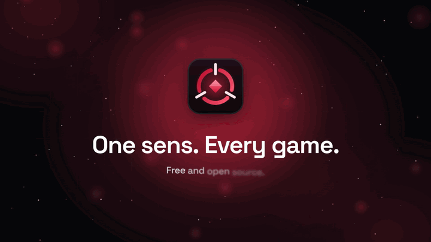
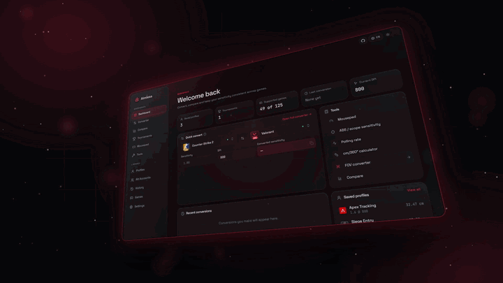
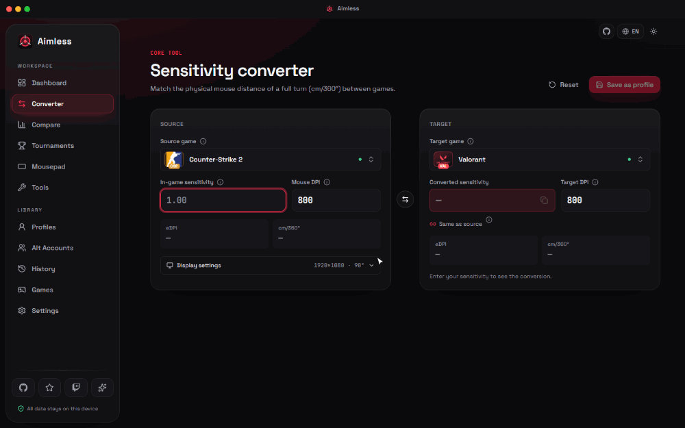
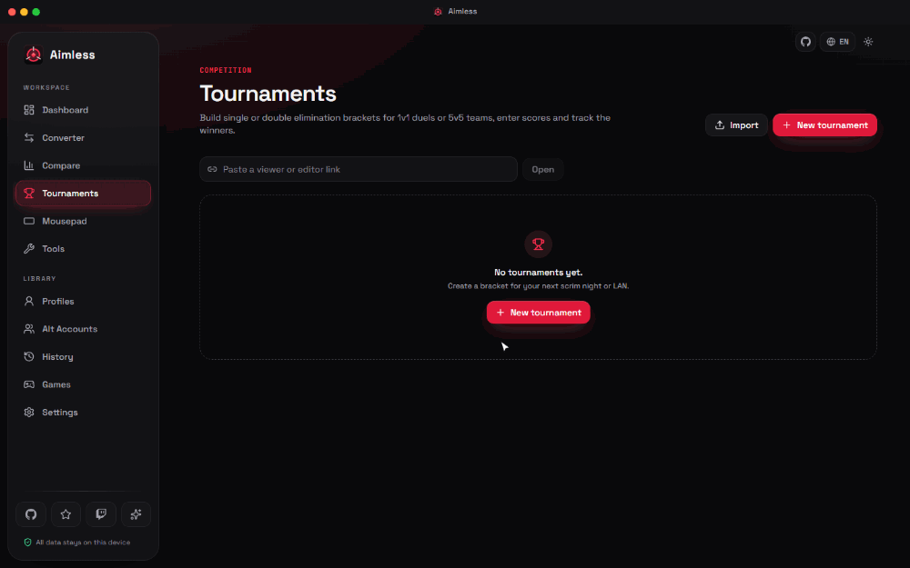
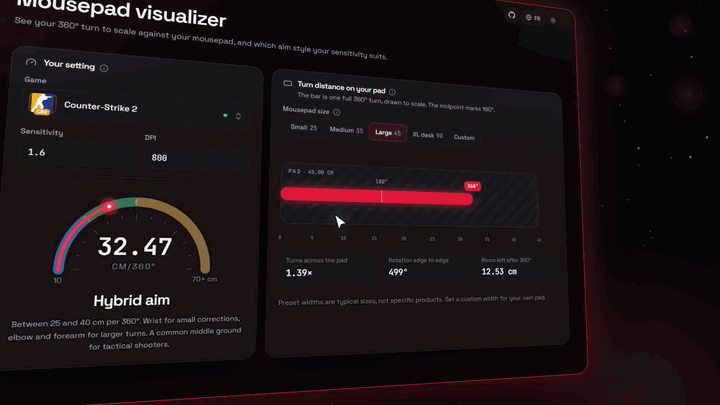
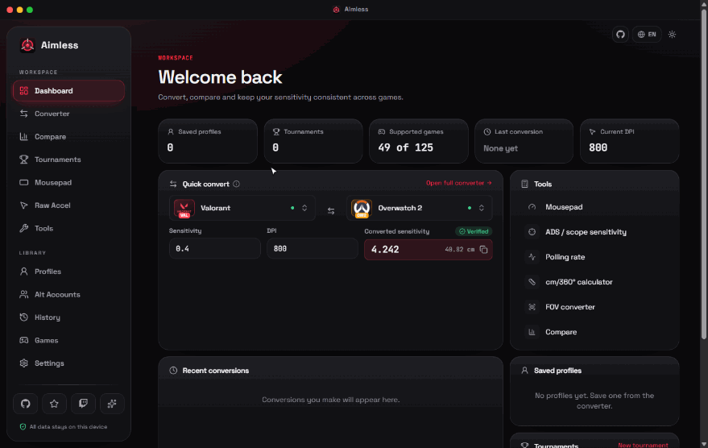
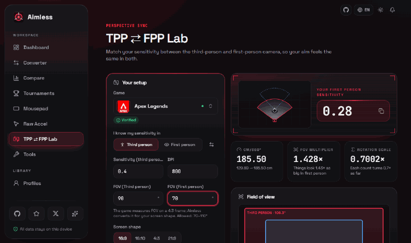
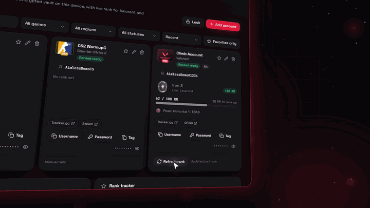

# Aimless

### One sens. Every game.
**سنس واحد. لكل الألعاب.**

Keep your exact muscle memory across 145+ shooter games, track your ranks, manage your alt accounts, and run live tournament brackets — free and offline.

[-ff2e4d?style=for-the-badge)](https://github.com/pzxe/Aimless/releases/latest)
[-1f1f25?style=for-the-badge)](https://github.com/pzxe/Aimless/releases/latest)

 

## 🎯 Instant Sensitivity Converter

Pick your main game, enter your sens and DPI, and get the exact matching sensitivity for 145+ FPS games, so your 360° turn feels identical everywhere. Every game is labelled *Verified* or *Approximate*, so you always know how much to trust the number.

## 🏆 Live Cloud Tournaments & Guest/Editor Links

Run 1v1, 2v2 or 5v5 single and double elimination brackets with a team randomizer and series scores. Hit **Go live** and share a link: fans watch the bracket update in real time from any browser or phone, a referee can enter scores from an editor link, and one more link drops a clean overlay straight into OBS.

## 📏 Mousepad Visualizer & Compare

See exactly how much desk space a full 360° turn takes on your mousepad. Change your sensitivity and the red turn line and the cm/360° gauge move with it, live. Convert your field of view and compare several games side by side too.

## 📈 Raw Accel Lab, eDPI Analyzer & 1:1 Blueprint Generator NEW in v2.5.0

Stop guessing your Raw Accel numbers. Tell Aimless your DPI, game and playstyle and it builds a curve for you, with a live read-out of your **Base eDPI** for calm micro-aim and your **Peak eDPI** for fast 180° flicks. Every setting shows up in a 1:1 copy of the Raw Accel window (exact field names, dark or classic white), so you can type it in within seconds.

Every curve you tweak is saved automatically: turn on **Compare** to lay an old one over the graph as a dashed **ghost curve**. Send a curve to a friend as a file or a code, and one click adapts it from their DPI to yours so it feels the same on your mouse. Then export a **PNG blueprint** or a showcase card and paste it straight into Discord.

## 🎥 TPP ⇄ FPP Lab NEW in v2.5.4

Switch between third-person and first-person without losing your aim. Pick a game, enter your sensitivity in one camera and the FOV of both, and Aimless gives you the matching sensitivity for the other one, with the effective cm/360° and a live look at what each camera sees.

## 🔐 Alt Accounts Vault & Live Rank Tracker

Keep your main and alt accounts in an encrypted vault on your own PC (AES-GCM, optional PIN lock), with one-click username and password copy. See your live Valorant and Overwatch 2 ranks and RR right inside the app.

 

## ⬇️ Install

1. Download **Setup.exe** (installs with shortcuts) or **NoInstall.zip** (unzip and run) from the **[latest release](https://github.com/pzxe/Aimless/releases/latest)**.
2. Run it. Windows may show a SmartScreen warning because the app isn't code-signed: click **More info → Run anyway**.
3. Done. New versions install themselves with one click in **Settings → Application Updates**.

<a href="https://github.com/pzxe/Aimless/releases/latest"><b>👉 github.com/pzxe/Aimless/releases/latest</b></a> · <a href="https://github.com/pzxe/Aimless"><b>⭐ Star the repo</b></a>

 

[MIT License](LICENSE) · Contributions welcome, see [CONTRIBUTING](CONTRIBUTING.md)

