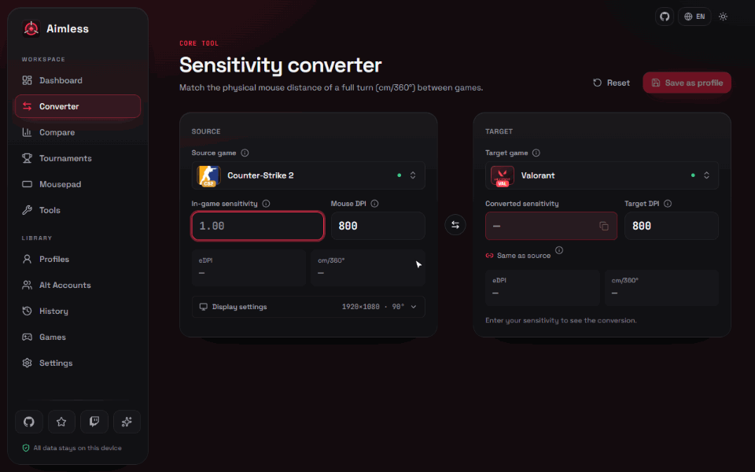
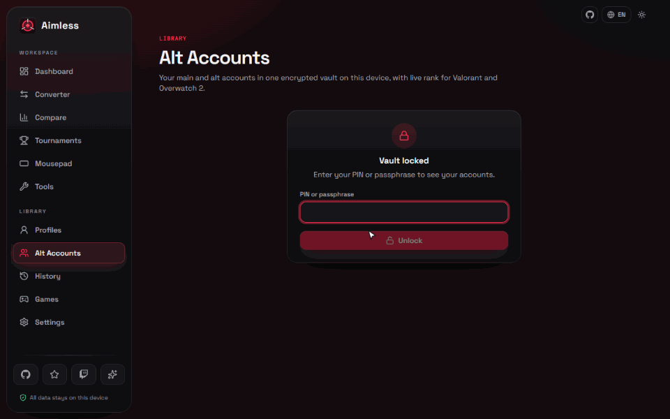
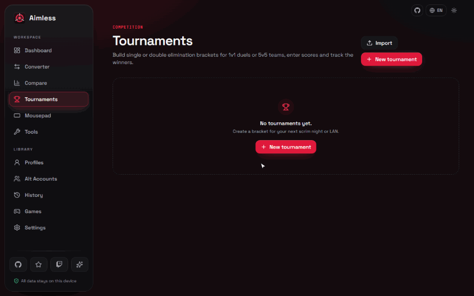
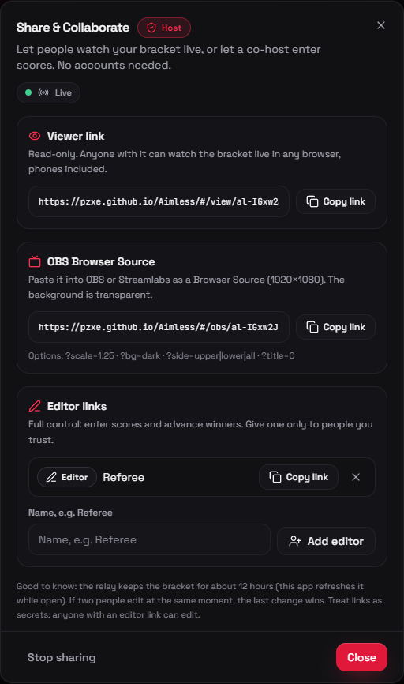
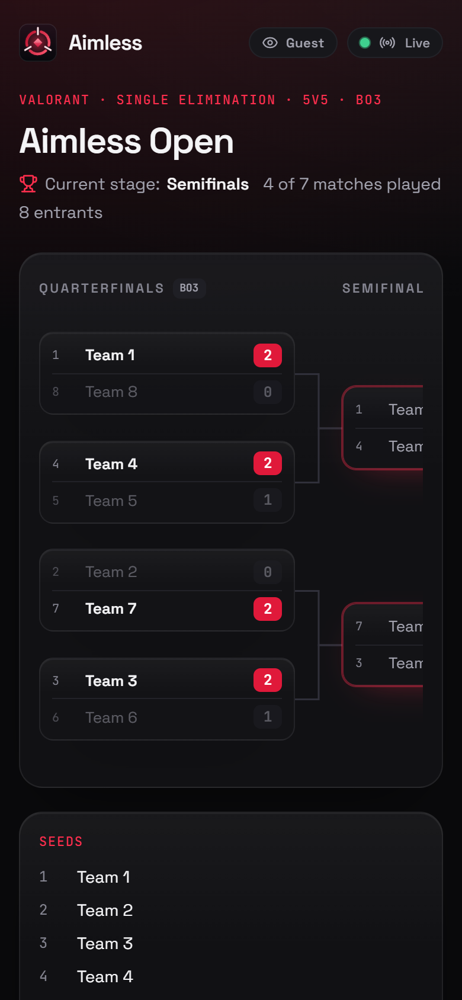
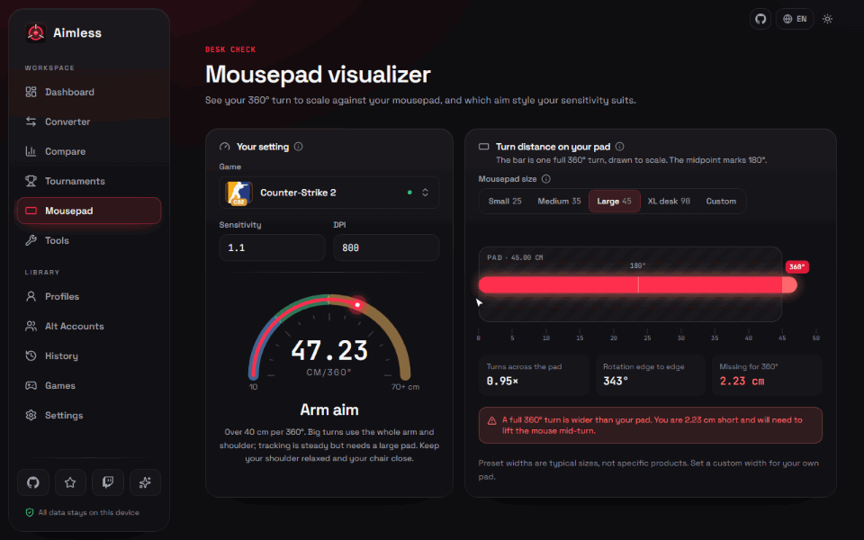

# Aimless

### One sens. Every game.
**سنس واحد. لكل الألعاب.**

Keep your exact muscle memory across 125+ shooter games, track your ranks, manage your alt accounts, and run tournament brackets — free and offline.

[-1f1f25?style=for-the-badge)](https://github.com/pzxe/Aimless/releases/latest)
[-1f1f25?style=for-the-badge)](https://github.com/pzxe/Aimless/releases/latest)

 

## 🎯 Instant Sensitivity Converter

Pick your main game, enter your sens and DPI, and get the exact matching sensitivity for 125+ FPS games, so your 360° turn feels identical everywhere. Every game is labelled *Verified* or *Approximate*, so you always know how much to trust the number.

## 🔐 Alt Accounts Vault & Live Rank Tracker

Save all your main and alt accounts on your own PC, with one-click username and password copy and an optional PIN lock. Check your live Valorant and Overwatch 2 ranks and RR right inside the app.

## 🏆 Tournament Bracket Maker

Host 1v1, 2v2 or 5v5 single and double elimination brackets with a built-in team randomizer, series score tracking and instant image export. Go live to share a link: friends and fans watch the bracket update in real time from any browser or phone, a referee can enter scores from an editor link, and one more link drops a clean overlay straight into OBS.

 

## 📏 Mousepad Visualizer & Multi-Game Compare

See exactly how much desk space a full 360° turn takes on your mousepad, and compare several games side by side.

 

## ⬇️ Download

1. Open the [latest release](https://github.com/pzxe/Aimless/releases/latest) and download **Setup.exe** (installs with shortcuts) or **NoInstall.zip** (unzip and run).
2. Run it. Windows may show a SmartScreen warning because the app isn't code-signed: click **More info → Run anyway**.
3. Done. Future versions install themselves with one click in **Settings → Application Updates**.

 

**[GitHub @pzxe](https://github.com/pzxe)** • **[Twitch 1usl](https://twitch.tv/1usl)** • **[X @87lx](https://x.com/87lx)** • **Discord 1usl**

[MIT License](LICENSE) · Contributions welcome, see [CONTRIBUTING](CONTRIBUTING.md)

